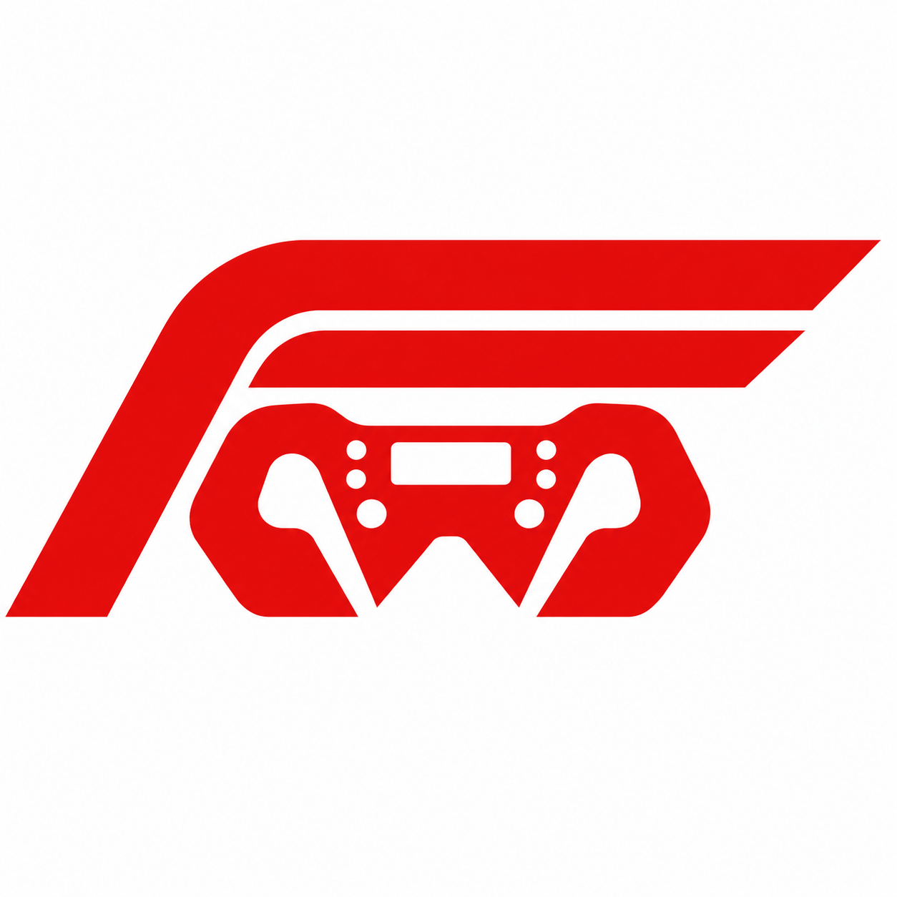

  

<h1 align="center">FormulaWheel (FW)</h1>

  <b>Turn your Android phone into an authentic F1 steering wheel controller</b> 
  <i>Live UDP Telemetry • 15 Shift LEDs • Virtual Xbox 360 Emulation</i>

  
  
  

---
# 🏎️ FormulaWheel (FW)

Turn your Android smartphone into an authentic Formula 1 steering wheel controller with live bi-directional UDP telemetry, 15 RPM shift LEDs, and virtual Xbox 360 controller emulation.

---

## 📥 Downloads

Grab the latest version from our [Releases Page](../../releases/latest):

| Component | File | Platform |
|---|---|---|
| **📱 Mobile Wheel App** | [`FormulaWheel.apk`](../../releases/latest/download/FormulaWheel.apk) | Android 8.0+ |
| **💻 Windows Companion** | [`FormulaWheel-Receiver-Windows.zip`](../../releases/latest/download/FormulaWheel-Receiver-Windows.zip) | Windows 10 / 11 (64-bit) |

---

## ✨ Features

- **🎮 Virtual Xbox 360 Emulation**: Games detect your phone as a genuine Xbox controller via the high-performance ViGEmBus driver.
- **⚡ Zero-Lag USB & Wi-Fi**: Play over USB (ADB reverse port 7331) for sub-millisecond wired responsiveness, or race wirelessly over 60Hz local Wi-Fi.
- **🎯 Realistic Gravity Steering**: Gyro/accelerometer-driven tilt steering with deadzone smoothing and progressive turn curves.
- **🏎️ Live Codemasters F1 Telemetry**:
  - 15 Dynamic Rev LEDs (5 Green, 5 Red, 5 Blue) driven directly by engine telemetry.
  - Live in-game Gear readout (`N`, `1`–`8`, `R`).
  - Real-time Engine RPM meter and session lap counter.
  - Live lap Delta time gap calculation.
- **📱 Phone Screen Optimization**: Built-in cutout margin padding to ensure phone camera punch-holes never block sliders or buttons.

---

## 🚀 Quick Setup Guide

### 1. Windows PC Setup
1. Download and extract **`FormulaWheel-Receiver-Windows.zip`**.
2. Make sure you have the free [Nefarius ViGEmBus Driver](https://github.com/nefarius/ViGEmBus/releases) installed (required for Xbox 360 controller emulation).
3. Run **`TSteerReceiver.exe`** as administrator and click **START SERVER**.

### 2. Android Phone Setup
1. Download and install **`FormulaWheel.apk`** on your Android device.
2. **Connect via USB (Recommended):**
   - Enable **USB Debugging** on your phone (*Settings → Developer Options → USB Debugging*).
   - Plug the phone into your PC via USB cable.
   - In the app, tap **CONNECT** $\to$ **🔌 USB**.
3. **Connect via Wi-Fi:**
   - Make sure your PC and phone are connected to the same Wi-Fi network.
   - Note the **PC IP** shown at the top of the Receiver window.
   - In the app, tap **CONNECT**, enter the IP, and tap **📡 WiFi**.

### 3. F1 Game Telemetry Settings
In F1 2018 / 2020 / 2023 / 2024 (or other Codemasters F1 titles):
- **UDP Telemetry**: `On`
- **UDP IP Address**: `127.0.0.1` (or your PC's IP)
- **UDP Port**: `20777`
- **UDP Format**: `2018` or `2020`

---

## 🕹️ Wheel Controls → Xbox 360 Mapping

| Wheel Control | Xbox 360 Button | Function |
|---|---|---|
| **Tilt Left / Right** | Left Stick X | Steering |
| **Right Slider** | Right Trigger (RT) | Progressive Throttle |
| **Left Slider** | Left Trigger (LT) | Progressive Brake |
| **Y** | Y | DRS (Drag Reduction System) |
| **X** | X | Neutral (N) / Shift Up |
| **B** | B | Pit Limiter / Request Pit |
| **A** | A | ERS Overtake |
| **LB / RB** | Left / Right Shoulder | Gear Down / Gear Up |
| **START / PAUSE** | Start | Pause Game / Menu |
| **D-Pad (▲ ▼ ◀ ▶)** | D-Pad | MFD Navigation & Car Settings |

---

## 🔒 Privacy

FormulaWheel does not collect, store, or transmit any personal information or device telemetry to external servers. All network transmissions are strictly local between your phone and your PC. See our full [Privacy Policy](privacy-policy.html).

---

## 📄 License
This project is free and open-source for personal use.
